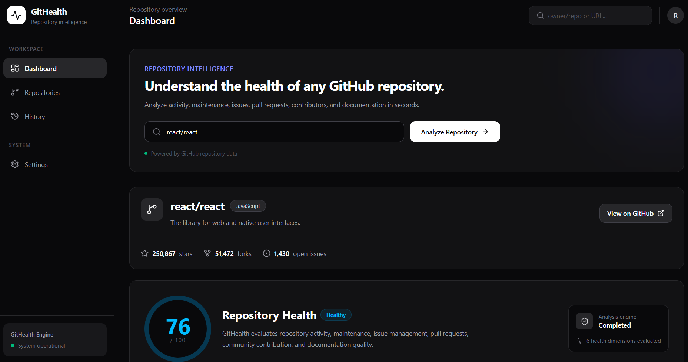
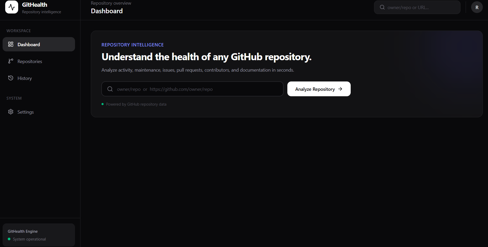
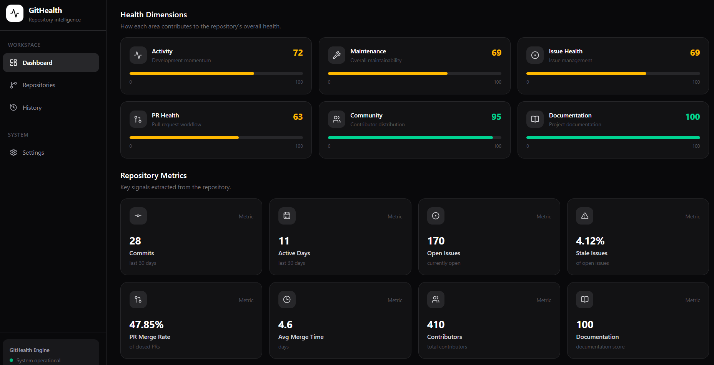
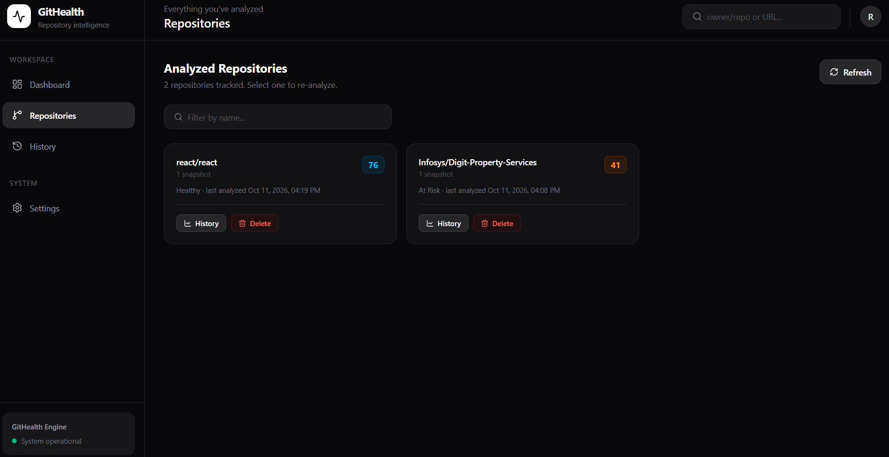

<div align="center">

# GitHealth

### GitHub Repository Health Dashboard

Score any public GitHub repository across six dimensions and track how that
score changes over time.


<br />



</div>

---

## Features

- **Six-dimension health score** — activity, maintenance, issue health, pull-request health, community and documentation, rolled up into one 0–100 score with a status (Excellent / Healthy / Needs Attention / At Risk / Poor).
- **Repository metrics** — commits and active days in the last 30 days, open and stale issues, PR merge rate and merge time, contributor count, documentation score.
- **Engineering insights** — critical, warning and positive recommendations generated from the repository's signals.
- **Score history** — every analysis can add a trend point, so you can see whether a repo is improving or decaying.
- **Per-user accounts** — email + password with JWT auth. Each account only sees the repositories it analyzed.
- **Fast repeat lookups** — analysis results are cached server-side for 10 minutes to stay well inside GitHub's rate limits.
- **Analyze from anywhere** — paste `owner/repo` or a full `github.com` URL into the dashboard or the top-bar search.

## Screenshots

### Sign in

Create an account or sign in. Your analyses and history stay private to you.


### Analyze a repository

Enter `owner/repo` or a GitHub URL to get started.



### Health dimensions and metrics

Six color-coded dimension scores, followed by the key signals behind them.



### Analyzed repositories

Every repository you've analyzed, with its latest score, status and snapshot count. Jump back to the dashboard, open its history, or delete it.



## Tech stack

| Layer    | Tech |
|----------|------|
| Frontend | React 19, Vite, Tailwind CSS 4, Recharts, axios, React Router |
| Backend  | Node, Express 5, Mongoose 9, Octokit |
| Storage  | MongoDB (health snapshots for the trend chart, user accounts) |

## Project layout

```
client/   Vite single-page app
server/   Express API: routes -> controllers -> services -> utils (pure analyzers)
docs/     README assets (screenshots)
```

## Getting started

### Prerequisites

- Node 18+
- A MongoDB connection string (local or Atlas)
- A GitHub personal access token with public-repo read access

### 1. Backend

```bash
cd server
npm install
cp .env.example .env      # then fill in the values
npm run dev               # http://localhost:5000
```

`.env` keys:

| Key                         | Purpose |
|-----------------------------|---------|
| `GITHUB_TOKEN`              | GitHub PAT used for all GitHub API calls |
| `MONGODB_URI`               | MongoDB connection string |
| `PORT`                      | API port (default `5000`) |
| `CLIENT_ORIGIN`             | Comma-separated allowed browser origins for CORS (default `http://localhost:5173`) |
| `JWT_SECRET`                | Secret for signing auth tokens (required in production; a dev fallback is used otherwise) |
| `JWT_EXPIRES_IN`            | Token lifetime, e.g. `7d` (default `7d`) |
| `SNAPSHOT_INTERVAL_MINUTES` | Minutes before an unchanged repo earns another trend point (default `60`; `0` = every analysis) |

> The server reads `.env` once at startup — restart it after changing a value.

### 2. Frontend

```bash
cd client
npm install
npm run dev               # http://localhost:5173
```

The client calls `VITE_API_BASE_URL` (see `client/.env.example`), defaulting to
`http://localhost:5000/api`. Users can override it per-browser on the Settings page.

### Run both with Docker

```bash
cp server/.env.example server/.env    # fill in the values
docker compose up --build
# client -> http://localhost:8080   server -> http://localhost:5000
```

### Tests

```bash
cd server && npm test     # health scoring unit tests
cd client && npm run lint
```

## App pages

| Route           | What it does |
|-----------------|--------------|
| `/login`        | Sign in or create an account |
| `/`             | Dashboard: analyze a repo and view its score, dimensions, metrics, trend and insights |
| `/repositories` | Every analyzed repo with its latest score; re-analyze, open history or delete |
| `/history`      | Score trend and snapshot table per repo, plus a recent-activity feed |
| `/settings`     | Backend URL override, connection test, and data management |

Everything except `/login` requires a session. The analyzed repo lives in the URL
(`/?owner=…&repo=…`), so links are shareable and the browser Back button works.

## API

### Authentication

Email + password, JWT bearer tokens (7-day default). The client stores the
token in `localStorage` and attaches it to every request; a `401` clears the
session and bounces to `/login`.

Every snapshot is stamped with its `user`, and all analyze/history/repository
queries are filtered by the caller's id — each account only ever sees what it
analyzed.

| Method | Path                 | Auth | Description |
|--------|----------------------|------|-------------|
| `POST` | `/api/auth/register` | —    | `{ name, email, password }` (name min 2 chars, password min 8) → `{ token, user }` |
| `POST` | `/api/auth/login`    | —    | `{ email, password }` → `{ token, user }` |
| `GET`  | `/api/auth/me`       | ✔    | Current account from the token |

### Endpoints

All routes below require `Authorization: Bearer <token>` and are scoped to that user.

| Method   | Path                             | Description |
|----------|----------------------------------|-------------|
| `GET`    | `/api/analyze/:owner/:repo`      | Full analysis + score. Records a history snapshot when the score changed or `SNAPSHOT_INTERVAL_MINUTES` (default 60) has passed since the last one. Responses are cached in-memory for 10 minutes. |
| `GET`    | `/api/history/:owner/:repo`      | Up to 30 prior snapshots, oldest first, for the trend chart. |
| `GET`    | `/api/history?limit=`            | The user's most recent snapshots across all their repos (max 100). |
| `GET`    | `/api/repositories`              | One row per analyzed repo with its latest snapshot and snapshot count. |
| `DELETE` | `/api/repositories/:owner/:repo` | Delete every stored snapshot for one repo. |
| `DELETE` | `/api/repositories`              | Delete all of the user's stored snapshots (Settings → danger zone). |

## Security note

Never commit real credentials. `server/.env` is git-ignored; if a token or
database password was ever committed, rotate it. Set a strong `JWT_SECRET`.
