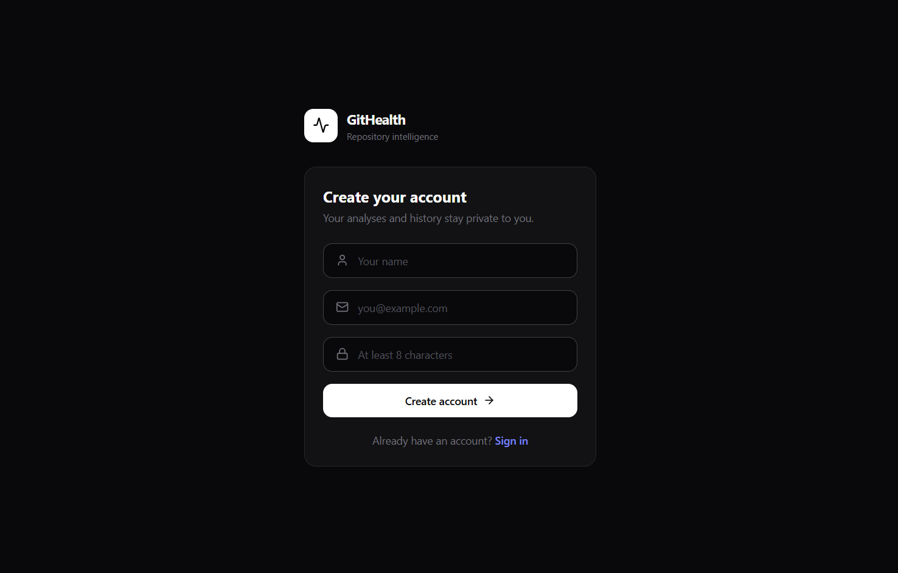

# GitHub Repository Health Dashboard

Analyze the health of any public GitHub repository across six dimensions
(activity, maintenance, issues, pull requests, community, documentation),
score it, and track the score over time as a trend.


## Screenshots

| Sign in | Analyzed repositories |
|---------|-----------------------|
|  |  |

**Repository metrics**


**Health trend and engineering insights**


**Score history**


| Recent activity | Settings |
|-----------------|----------|
|  |  |

## Stack

| Layer    | Tech |
|----------|------|
| Frontend | React 19, Vite, Tailwind CSS 4, Recharts, axios |
| Backend  | Node, Express 5, Mongoose 9, Octokit |
| Storage  | MongoDB (health snapshots for the trend chart) |

## Project layout

```
client/  Vite single-page app
server/  Express API: routes -> controllers -> services -> utils (pure analyzers)
```

## Prerequisites

- Node 18+
- A MongoDB connection string (local or Atlas)
- A GitHub personal access token with public-repo read access

## Setup

### 1. Backend

```bash
cd server
npm install
cp .env.example .env      # then fill in the values
npm run dev               # http://localhost:5000
```

`.env` keys:

| Key             | Purpose |
|-----------------|---------|
| `GITHUB_TOKEN`   | GitHub PAT used for all GitHub API calls |
| `MONGODB_URI`    | MongoDB connection string |
| `PORT`           | API port (default `5000`) |
| `CLIENT_ORIGIN`  | Comma-separated allowed browser origins for CORS (default `http://localhost:5173`) |
| `JWT_SECRET`     | Secret for signing auth tokens (required in production; a dev fallback is used otherwise) |
| `JWT_EXPIRES_IN` | Token lifetime, e.g. `7d` (default `7d`) |
| `SNAPSHOT_INTERVAL_MINUTES` | Minutes before an unchanged repo earns another trend point (default `60`; `0` = every analysis) |

### 2. Frontend

```bash
cd client
npm install
npm run dev               # http://localhost:5173
```

The client calls `VITE_API_BASE_URL` (see `client/.env.example`), defaulting to
`http://localhost:5000/api`. Users can override it per-browser on the Settings page.

### Run both with Docker

```bash
cp server/.env.example server/.env    # fill in the values
docker compose up --build
# client -> http://localhost:8080   server -> http://localhost:5000
```

## Authentication

Email + password, JWT bearer tokens (7-day default). The client stores the
token in `localStorage` and attaches it to every request; a `401` clears the
session and bounces to `/login`.

Every snapshot is stamped with its `user`, and all analyze/history/repository
queries are filtered by the caller's id — each account only ever sees what it
analyzed.

| Method | Path                 | Auth | Description |
|--------|----------------------|------|-------------|
| `POST` | `/api/auth/register` | —    | `{ name, email, password }` (name min 2 chars, password min 8) → `{ token, user }` |
| `POST` | `/api/auth/login`    | —    | `{ email, password }` → `{ token, user }` |
| `GET`  | `/api/auth/me`       | ✔    | Current account from the token |

## API

All routes below require `Authorization: Bearer <token>` and are scoped to that user.

| Method   | Path                        | Description |
|----------|-----------------------------|-------------|
| `GET`    | `/api/analyze/:owner/:repo` | Full analysis + score. Records a history snapshot when the score changed or `SNAPSHOT_INTERVAL_MINUTES` (default 60) has passed since the last one. Responses are cached in-memory for 10 minutes. |
| `GET`    | `/api/history/:owner/:repo` | Up to 30 prior snapshots, oldest first, for the trend chart. |
| `GET`    | `/api/history?limit=`       | The user's most recent snapshots across all their repos (max 100). |
| `GET`    | `/api/repositories`         | One row per analyzed repo with its latest snapshot and snapshot count. |
| `DELETE` | `/api/repositories/:owner/:repo` | Delete every stored snapshot for one repo. |
| `DELETE` | `/api/repositories`         | Delete all of the user's stored snapshots (Settings → danger zone). |

## Frontend routes

`/login` auth · `/` Dashboard · `/repositories` analyzed list · `/history` score trends + activity feed · `/settings` API URL + data management. Client-side routing via `react-router-dom`; everything except `/login` requires a session.

## Security note

Never commit real credentials. `server/.env` is git-ignored; if a token or
database password was ever committed, rotate it. Set a strong `JWT_SECRET`.
